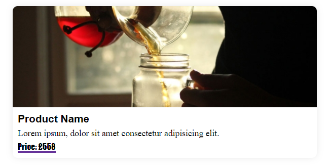
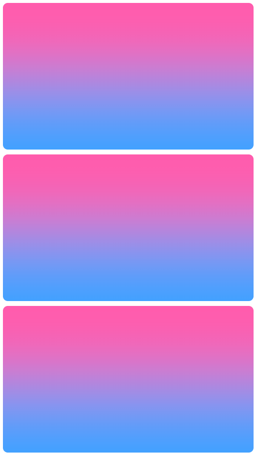
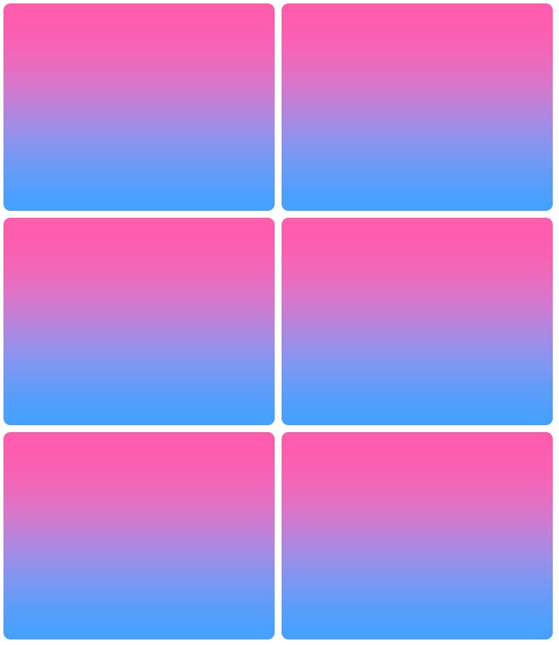
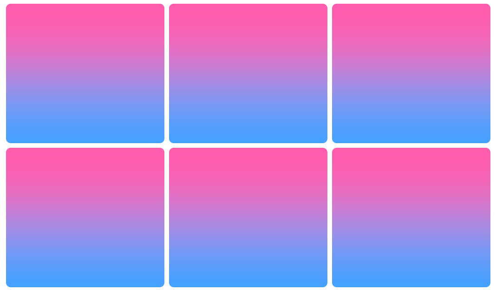
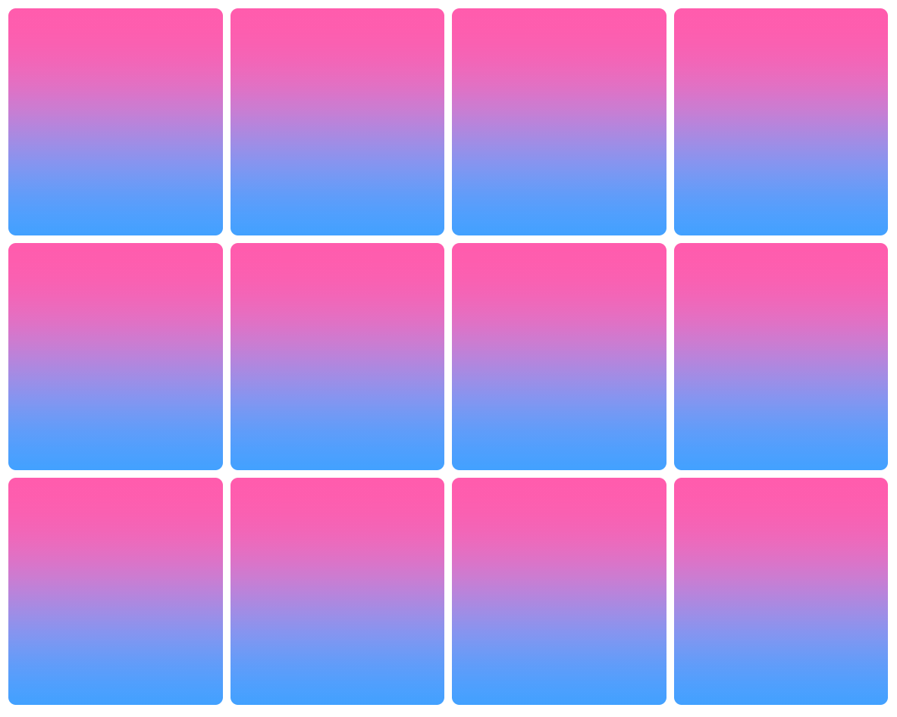

# Live Pairing Tech Test (original exercise)

The classic product card + pagination exercise, preserved for interviews alongside the Bonhams-themed variants.

## Minimum requirements

- **Node 24** (`nvm use` reads `.nvmrc`)
- Your favourite IDE

## Intro

- Test is **60 minutes** long
- **You do not need to finish everything**
- Work how you normally would (docs, questions, pairing)
- Relax and have fun — we are here to help

## Goal

| Block | Time | Focus |
|-------|------|--------|
| 1 — Styling | 20 min | Card + responsive CSS grid with **styled-components** |
| 2 — React | 25 min | `getServerSideProps` + in-memory pagination (12 per page) |
| 3 — Testing | 15 min | Keep `npm test` green |

We will be looking for:

- Clean CSS styles
- Sound state and data fetching

## Where to start

```bash
npm ci
npm run dev
```

Open [http://localhost:3000](http://localhost:3000).

## Block 1 (Styling) — 20m

**Use styled-components and CSS grid.**

### Card



- Card: padding 10px; margin 10px; border-radius 10px; box-shadow `0px 0px 15px -2px #e0e0e0`
- Image: height 200px; full width
- Title: sans-serif; 1.3rem; bold
- Description: serif; 1.1rem
- Price: prepend `"Price"` only when a value exists; fantasy font; 1rem; underline 3px rebeccapurple

### Responsive layout / grid

- Up to **4 cards** at 1200px width
- Each card **min 260px**
- Spacing **10px**

  
  
  


### Pagination (optional if time)

Style `<` and `>` as buttons.


## Block 2 (React) — 25m

- Fetch all results from `/api/product` using **`getServerSideProps`** (starter already wired — verify it works)
- API always returns **25** products (no extra requests)
- Paginate **in memory** with **12 per page**
- Pagination updates the visible cards

## Block 3 (Testing) — 15m

```bash
npm test
```

All tests should pass. Extend coverage if you change shared components or the API.

## Stack

- Next.js **16** (Pages Router)
- Node **24**
- TypeScript
- styled-components **6**
- Jest + Testing Library + MSW

## API

`GET /api/product` → `{ results: Product[] }` (25 deterministic items from `data/products.ts`).
